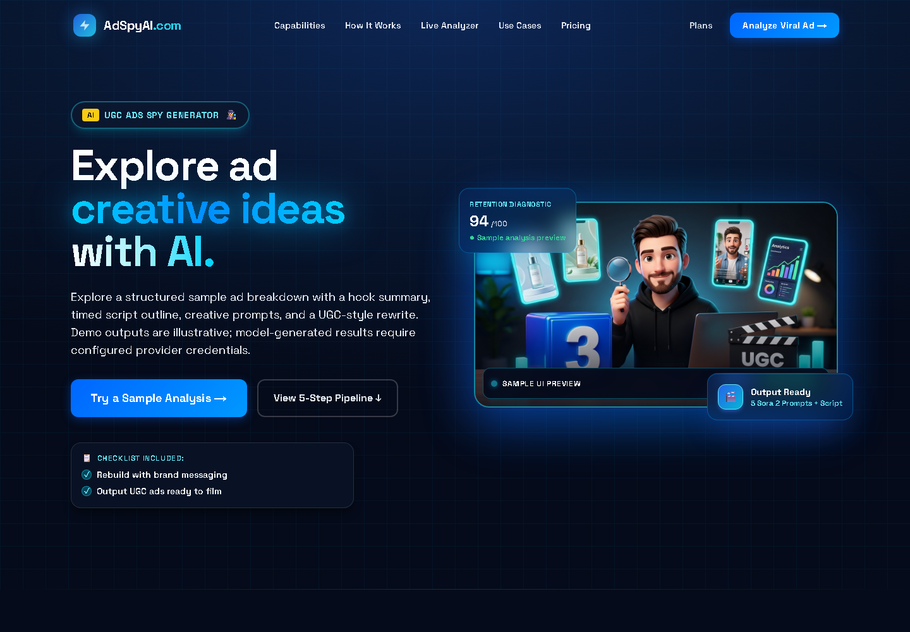
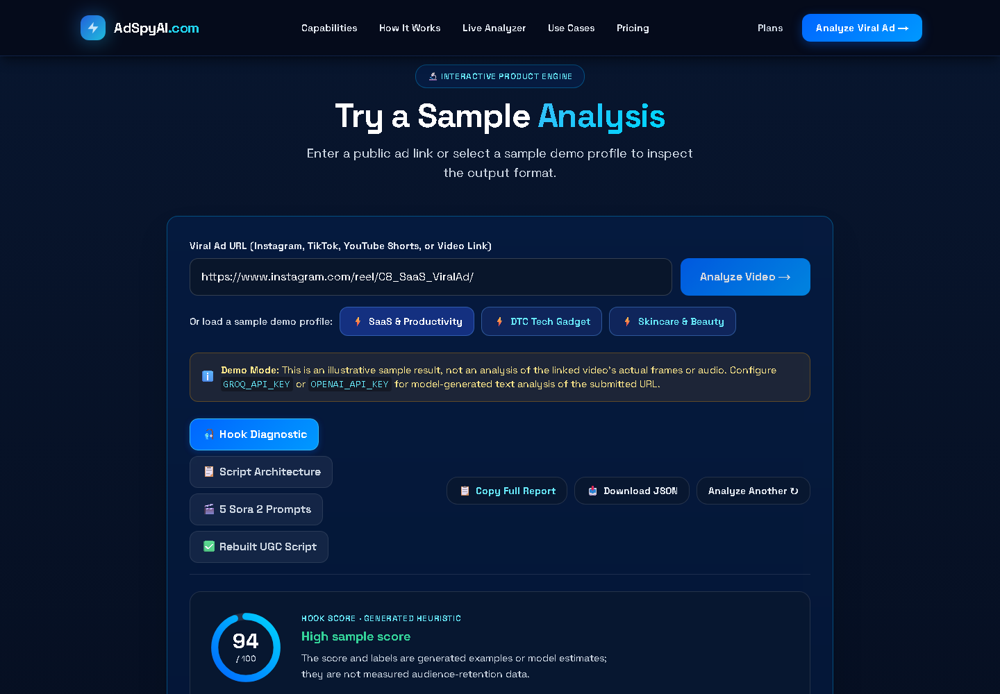

# AdSpy AI

An AI-assisted ad analysis prototype with a Next.js web app and an Expo mobile companion. Provide a public Instagram Reel, TikTok, or YouTube Shorts URL as context for a structured text response. The current prototype does not fetch or inspect video frames or audio. It uses configured Groq/OpenAI text APIs when available and clearly returns illustrative demo content otherwise.

> **Project status:** portfolio prototype. The UI, demo analyzer, and configurable model integrations are present. Demo scores and generated scripts are illustrative outputs, not measured performance claims. Configure live API and payment credentials before enabling those integrations for real users.

Legacy demo URL: [adspyai.infinityfreeapp.com](http://adspyai.infinityfreeapp.com). Its public page was blocked by an anti-bot check during this review, so availability and equivalence to this repository have not been verified.

## Product views

| Web app — landing page | Web app — analysis output |
| --- | --- |
|  |  |

The screenshots are captured from this repository running locally. The analysis example is explicitly in demo mode.

## What it does

- Accepts and validates a public social-video URL as text context; it does not fetch the media.
- Produces a hook score, hook classification, emotional framing, and a time-coded script outline.
- Returns a UGC-style rewrite and Sora prompt ideas.
- Uses Groq first and OpenAI as a fallback when server credentials are configured; otherwise returns deterministic demo content.
- Includes an Expo companion with analysis screens, four result tabs, and local history stored on-device.
- Includes Razorpay checkout route scaffolding. Sandbox orders are previews only and cannot grant paid entitlements.

## Architecture and stack

See [architecture and data flows](docs/architecture.md) for the web, model-routing, payment, and mobile diagrams and the verified stack list.

| Area | Technologies in this repository |
| --- | --- |
| Web | Next.js 16 App Router, React 19, TypeScript, Tailwind CSS, Framer Motion |
| Model APIs | Groq chat completions and OpenAI integration, selected by server environment variables |
| Payments | Razorpay SDK and HMAC-SHA256 verification helpers |
| Mobile | React Native 0.88, Expo SDK 58, React 19, TypeScript, React Navigation, AsyncStorage |
| Visuals | Project-owned SVG/CSS illustration, local sample videos, generated demo analysis data |

## Run locally

### Web app

```bash
cd website
npm ci
copy .env.example .env.local
npm run dev
```

Open <http://localhost:3000>. Leaving the optional model keys empty uses demo mode. Never commit `.env.local`.

```bash
npm run build
npm start
```

### Mobile app

```bash
cd mobile
npm ci
npx expo start
```

Use Expo Go or an Android emulator. Set a backend URL in the app settings to connect it to a running web API. The app's saved history is local to the device.

## Environment variables

Copy the examples in `website/.env.example` and `mobile/.env.example`. Server credentials belong only in `website/.env.local` or the deployment provider's encrypted environment settings. Do not expose server secrets through `NEXT_PUBLIC_*` variables.

For paid plan activation, configure Razorpay's server-side key ID and secret. A sandbox checkout response is a UI preview and must not be treated as a successful payment. Webhook event deduplication and free-tier rate limiting currently use in-memory storage; use shared persistent storage before scaling across serverless instances.

## Validation

- `npm run build` — production compilation and static generation.
- The no-credentials payment verification path is checked to reject sandbox entitlement requests.
- Mobile TypeScript check: `npx tsc --noEmit`.

## Security and release status

The mobile dependency audit still reports 10 transitive advisories through React Navigation 6 and Expo fingerprint/minimatch. The mobile app is a prototype and should not be shipped to end users until those dependency paths are resolved and native-device tests pass. A credential-like Groq value found in the original mobile defaults was removed; if it was a real key, revoke and rotate it at Groq.

## Repository layout

```text
website/   Next.js web app, API routes, and server-side model/payment adapters
mobile/    Expo React Native companion app and local history
docs/      Architecture diagrams and locally captured product screenshots
```

## Project ownership

This is a personal project. The implementation spans the web UI, API integration, demo mode, payment scaffolding, and mobile companion. Third-party model output and external platform URLs depend on configured services and may change independently.
