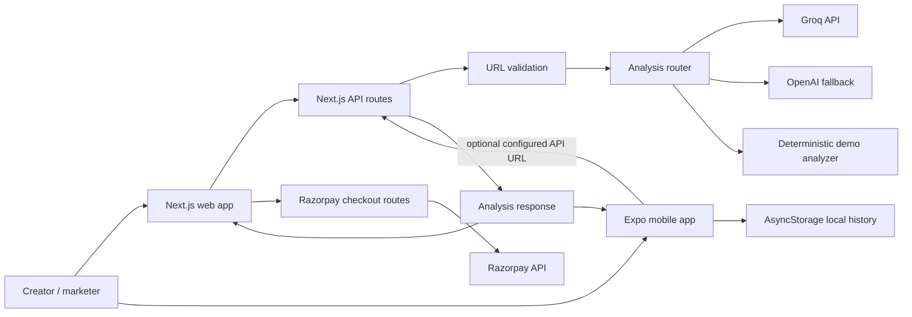
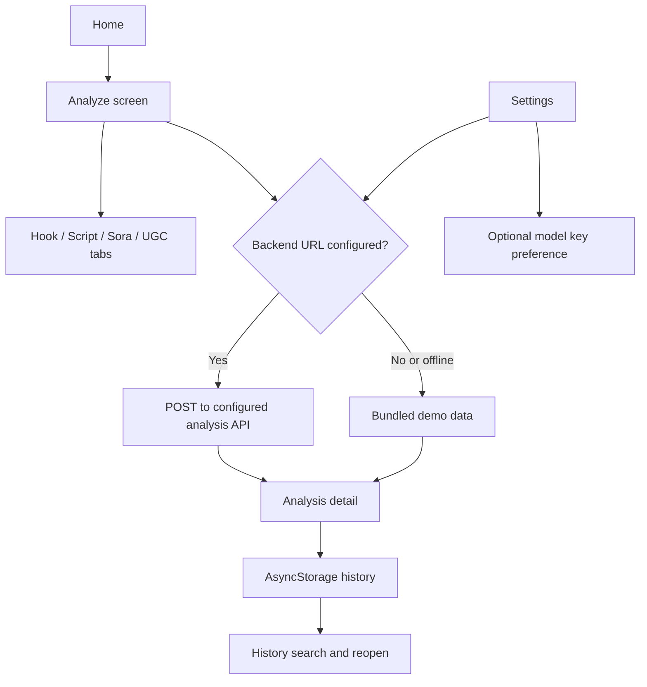

# AdSpy AI architecture

This document reflects the source currently in this repository. External model calls and payment processing require valid environment configuration. Demo-mode results are synthetic examples, not observed ad performance.

## System view



## Web analysis request

```mermaid
sequenceDiagram
  actor User
  participant UI as Next.js UI
  participant API as /api/analyze
  participant Guard as URL + free-tier checks
  participant Model as Groq / OpenAI
  participant Demo as Demo analyzer

  User->>UI: Paste public ad URL
  UI->>API: POST { url, optional entitlementToken }
  API->>Guard: Validate request and URL
  Guard-->>API: Accepted or 4xx/429 response
  API->>Model: Groq first; OpenAI fallback when configured
  alt model returns a valid result
    Model-->>API: Structured analysis fields
  else missing key or provider failure
    API->>Demo: Create deterministic demo result
    Demo-->>API: Illustrative analysis payload
  end
  API-->>UI: { result, isDemo, provider, note }
```

**Boundary:** the analyzer accepts and passes a public URL to the model prompt; it does not download the social video or inspect private content. The in-memory free-tier counter is process-local and is not a shared production rate limiter.

## Payment flow

```mermaid
sequenceDiagram
  actor Customer
  participant UI as Pricing UI
  participant API as Payment API routes
  participant RP as Razorpay

  Customer->>UI: Select paid plan and billing interval
  UI->>API: POST /api/payments/create-order
  API->>API: Validate plan and use server-side price table
  alt Razorpay configured
    API->>RP: Create order
    RP-->>UI: Checkout order details
    Customer->>RP: Complete checkout
    RP-->>UI: order ID, payment ID, signature
    UI->>API: POST /api/payments/verify
    API->>API: Check payment signature and configured credentials
    API-->>UI: Signed entitlement token
  else no Razorpay credentials
    API-->>UI: Sandbox preview order
    UI->>API: Attempt verify
    API-->>UI: 503; sandbox cannot activate a paid plan
  end
```

**Operational note:** the webhook and event-deduplication helpers are present, but their current registry is in-memory. Persist order state and event IDs in shared storage before production use.

## Mobile data flow



History is device-local. The mobile app does not provide a shared account or cloud sync in this version.

## Stack verified from manifests and source

- **Web:** Next.js 16, React 19, TypeScript, Tailwind CSS 3, Framer Motion 11.
- **Web APIs:** Next.js route handlers, Groq chat-completions endpoint, OpenAI adapter, Razorpay SDK.
- **Mobile:** React Native 0.88, Expo SDK 58, React 19, TypeScript, React Navigation, AsyncStorage, Expo Clipboard/Haptics/Sharing.
- **Persistence:** AsyncStorage on mobile; process-memory maps/sets for web rate limits and payment event deduplication.
- **Hosting path:** web app supports Vercel-style Next.js deployment; mobile app can run with Expo Go or an Android emulator.

## Source map

- Web UI: `website/app/`, `website/components/`
- Analysis API and model routing: `website/app/api/analyze/route.ts`, `website/lib/analyzeAd.ts`
- Payment API and signing helpers: `website/app/api/payments/`, `website/lib/plans.ts`, `website/lib/razorpay.ts`
- Mobile navigation, views and storage: `mobile/src/navigation/`, `mobile/src/screens/`, `mobile/src/lib/`
